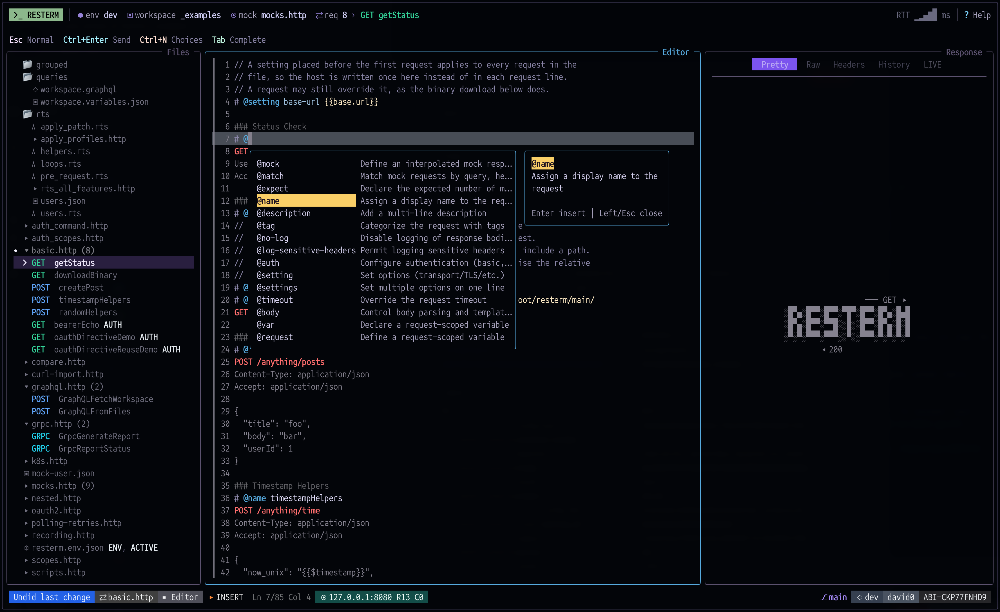
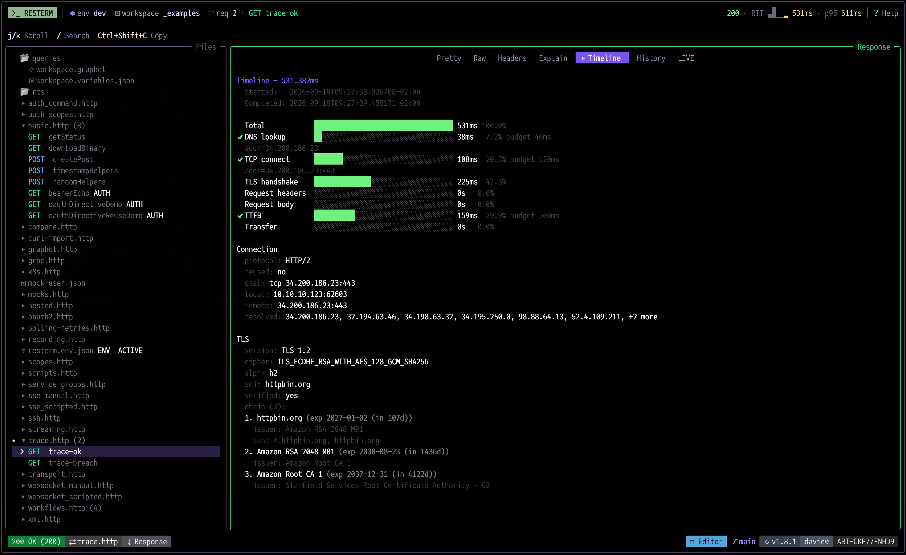
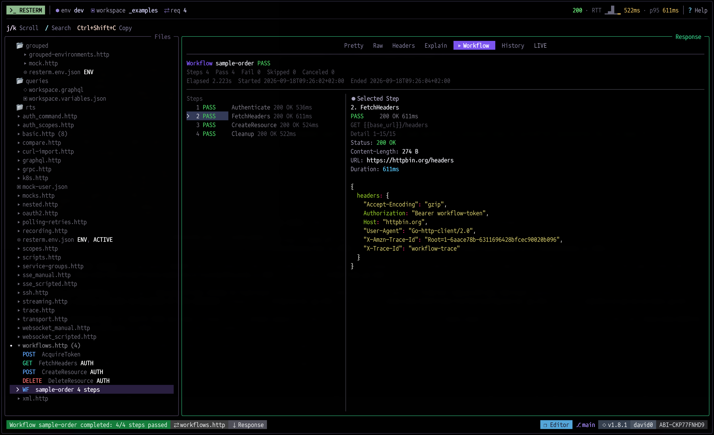
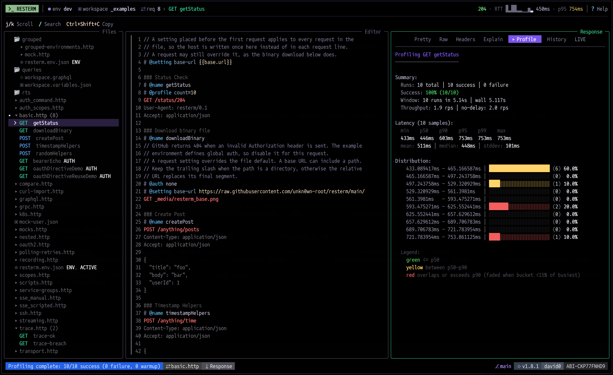
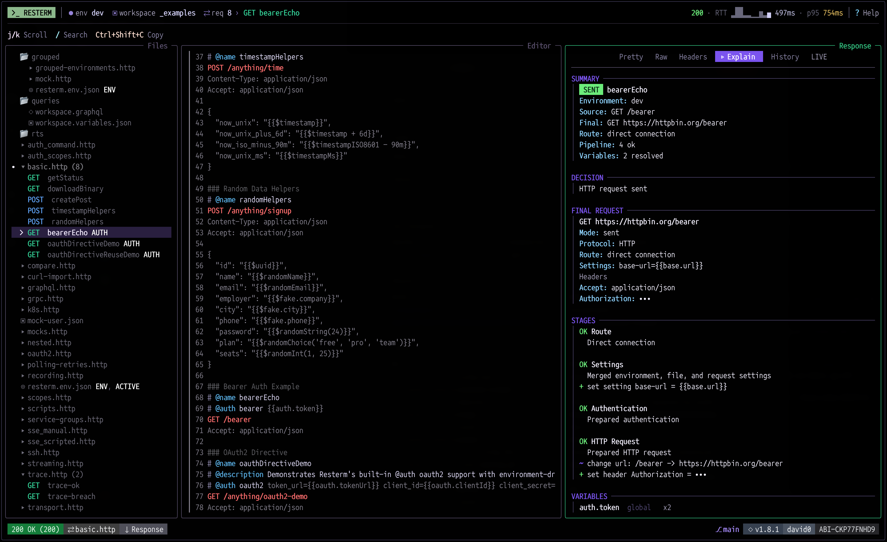
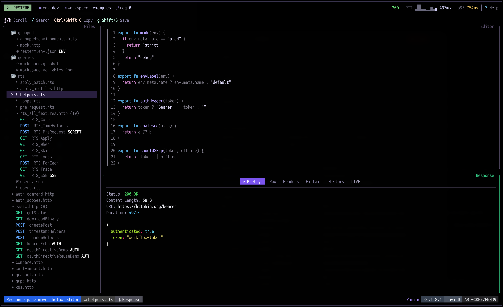

<h1 align="center">
  
  <br>
  Resterm
</h1>

<p align="center">
  <em>An API-as-code workbench for the terminal.</em>
  <br>
  <a href="https://resterm.app">resterm.app</a> · <a href="https://resterm.app/docs/">docs</a>
</p>

<p align="center">
  
</p>

Resterm is a code-first API client built around plain `.http`/`.rest` files. A request is a few lines of text you can read, diff and keep in git, and the same goes for workflows and local mocks. You send them from the terminal UI while you work, and `resterm run` runs the same files in CI. If your API sits behind an SSH bastion or inside a Kubernetes cluster, Resterm opens the tunnel or port-forward for you.

## Features

- HTTP, GraphQL, gRPC (with reflection and streaming), WebSocket and SSE
- environment files, grouped environments, dotenv files and OS variables
- bearer tokens, OAuth 2.0 (client credentials, password, and authorization code with PKCE), and tokens from CLIs you already use, like `gh auth token`
- TLS client certificates, custom root CAs, proxies, HTTP/2 and a cookie jar per environment
- captures and checks with `@capture` and `@assert`, plus `@poll` and `@retry`
- workflows that chain requests into steps, with `@if` and `@for-each`
- RestermScript for logic and `@rts test` blocks
- editor with Vim motions, syntax highlighting, completion for directives, headers, file paths, and inline diagnostics
- `@compare` to send one request to several environments and diff the results
- timeline tracing with per-phase budgets, and export to OpenTelemetry
- `@profile` with latency stats, a histogram, P95 and P99
- SSH tunnels and Kubernetes port-forwards that Resterm opens for the request
- local mock servers from your `.http` files, and a recording proxy that turns real traffic into requests or mocks
- `resterm run` for CI, with text, JSON or JUnit output and exit codes that tell a failed check from a TLS or tunnel error
- headless Go API to run the same files from your own Go code
- import from curl and OpenAPI, and share collections as bundles or zip files
- custom key bindings and themes
- open a file in `$EDITOR`, or a response body in your default app

No account and no telemetry.

> [!NOTE]
> Resterm has no MCP server or built-in AI features. If you want your LLM to understand Resterm, point it at the Markdown docs in [`docs/`](docs/) or at [resterm.app/docs](https://resterm.app/docs/).

## Screenshots

<p align="center">
  <strong>Trace and timeline</strong>
</p>

<p align="center">
  
</p>

<details>
<summary>Click to see more of the UI</summary>

<p align="center">
  <strong>Workflows</strong>
</p>

<p align="center">
  
</p>

<p align="center">
  <strong>Profiler</strong>
</p>

<p align="center">
  
</p>

<p align="center">
  <strong>Explain</strong>
</p>

<p align="center">
  
</p>

<p align="center">
  <strong>RestermScript</strong>
</p>

<p align="center">
  
</p>

</details>

## Install

macOS and Linux:

```bash
brew install resterm
# or
curl -fsSL https://raw.githubusercontent.com/unkn0wn-root/resterm/main/install.sh | bash
```

Windows:

```powershell
iwr -useb https://raw.githubusercontent.com/unkn0wn-root/resterm/main/install.ps1 | iex
```

With Go 1.25 or newer:

```bash
go install github.com/unkn0wn-root/resterm/cmd/resterm@latest
```

Prebuilt binaries for macOS, Linux and Windows are on the [releases page](https://github.com/unkn0wn-root/resterm/releases). The Linux binaries need **glibc 2.32** or newer.

To update a Homebrew installation, run `brew upgrade resterm`. For release binaries or installations made with the scripts, run `resterm --update`. If you installed with Go, rerun the `go install` command above. More in the [install guide](https://resterm.app/docs/install/).

## Quick start

```bash
mkdir my-api && cd my-api
resterm init
resterm
```

`resterm init` creates a `requests.http` file with a few sample requests and local mocks to answer them, so you don't need a real API to try it. Press `g Shift+M` to start the mock server, move the cursor to a request and press `Ctrl+Enter` to send it. Press `?` for help at any time.

You don't need `init` either. Run `resterm`, type a URL or paste a curl command, and press `Ctrl+Enter`.

The same file also runs without the UI. Start the mocks in one terminal and run a request in another:

```bash
resterm mock requests.http                       # terminal 1
resterm run --request CreateUser requests.http   # terminal 2
```

## Request files

Resterm reads the standard `.http` format and adds `# @` directives on top for settings and automation:

```http
# @setting base-url https://api.example.com/v1/

### Create users
// Send this request once for each name in the list.
# @for-each ["david", "tom"] as name
# @when env.meta.name == "dev"
# @assert response.statusCode == 201
POST users
Content-Type: application/json

{"name":"{{= name }}"}
```

A `@setting` before the first request applies to the whole file. `###` starts a new request. Directives above a request can repeat it, skip it or check the response.

There are more examples in [`_examples/`](_examples/), and every directive is listed in the [request file reference](https://resterm.app/docs/request-files/).

## Documentation

The full docs are at [resterm.app/docs](https://resterm.app/docs/). Good places to start are [workflows](https://resterm.app/docs/workflows/), [mock servers](https://resterm.app/docs/mock-servers/), [recording](https://resterm.app/docs/recording/), [the CLI](https://resterm.app/docs/cli/) and [RestermScript](https://resterm.app/docs/rts/).

Inside the TUI, `:help <topic>` opens the built-in manual and `:docs <topic>` opens the same page on the website.

To run request files from your own Go code, see the [`headless`](./headless) package.

## Sponsor

Resterm is and always will be free and open source. If you like my work, you can [sponsor it on GitHub](https://github.com/sponsors/unkn0wn-root).

## License

[Apache License 2.0](./LICENSE).
